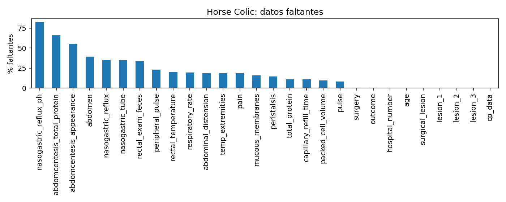

# Horse Colic — exploración y aprendizaje supervisado

Estudio académico de portafolio de Ariel Aravena. Incluye exploración descriptiva, regresión del pulso y clasificación retrospectiva de lesión quirúrgica. Preparado con asistencia de ChatGPT/Codex, declarada en los notebooks.

## Reproducir

Python 3.12 en un entorno virtual nuevo:

```sh
python -m pip install -r requirements.txt
python scripts/reproducir.py
```

Se ejecuta cada notebook secuencialmente en un proceso limpio y se capturan salidas reales de IPython y figuras. Este camino evita la dependencia de sockets de Jupyter; también pueden abrirse los notebooks en Jupyter y ejecutarse en orden desde la raíz. Resultados en `resultados/`.

## Metodología

300 filas del archivo horse-colic.data. El archivo de 68 casos históricos de test de UCI no se usa. La prueba de este estudio se obtiene separando grupos dentro de las 300 filas; no debe confundirse con ese test oficial.
Semilla 42, separación por hospital_number y cinco folds agrupados. Imputación, codificación y escalamiento dentro de cada Pipeline/fold. Comparación contra DummyRegressor y DummyClassifier. La selección usa validación, no prueba. La exploración no exporta un CSV globalmente imputado para entrenar modelos.

## Resultados reproducidos

Random Forest fue seleccionado por validación en ambas tareas. En regresión tuvo RMSE de prueba 18,9614 frente a 27,9892 de la referencia media; Ridge obtuvo 16,8513 en prueba, pero no se cambió la selección. En clasificación Random Forest obtuvo F1 de prueba 0,7857 frente a 0,7573 de la referencia; logística obtuvo 0,8049 sin cambiar la selección por validación.
La variación entre familias y el tamaño pequeño del conjunto impiden inferir utilidad clínica. No es un sistema de diagnóstico ni una recomendación de cirugía.



Ver `resultados/configuracion.json`, tablas de búsqueda y particiones. Los tiempos dependen del equipo; no se espera que sean idénticos.

## Procedencia y derechos

Código propio con derechos reservados. Datos de McLeish y Cecile, UCI, CC BY 4.0: ver `data/ATRIBUCION.md` y `data/manifest.json`. Los datos conservan su licencia aunque el código tenga derechos reservados.
La versión canónica de modelado se eligió por incluir referencias, comparadores Dummy y manifiesto de ejecución; no por el nombre de archivo corregido. Se conservan las decisiones y limitaciones metodológicas, sin importar material privado de Amalan.
